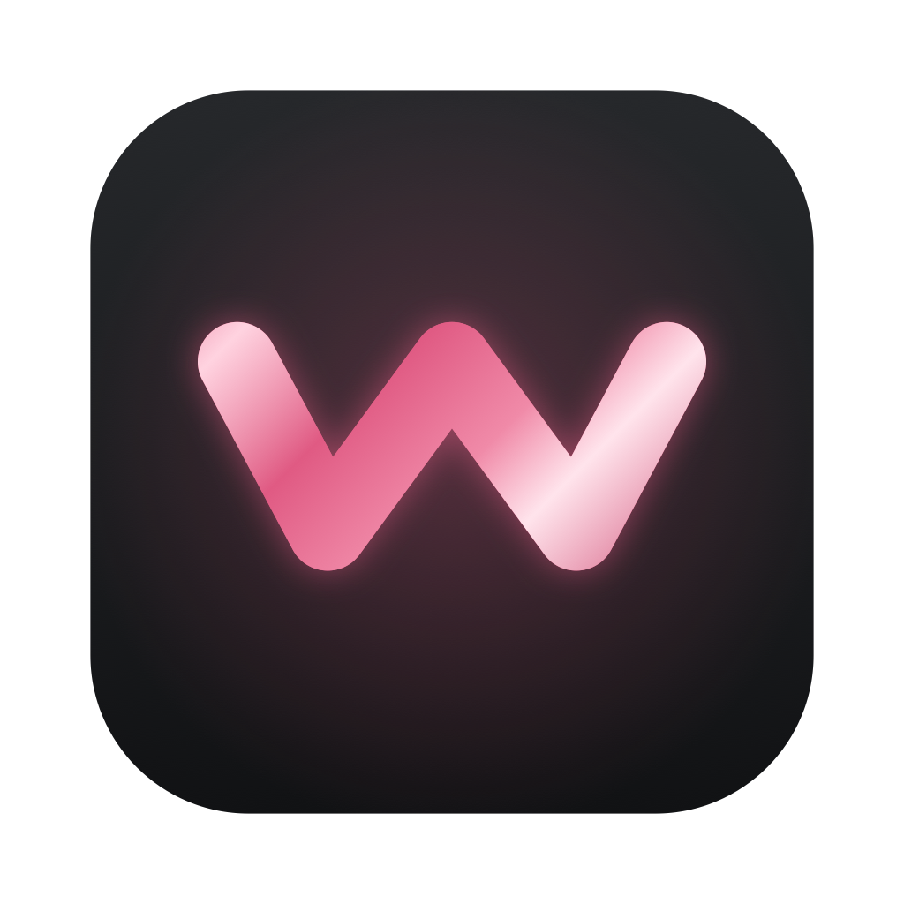

# WYNIX

<p align="center">
  
</p>

Windows games and apps on your Apple Silicon Mac. Free, no VM, no subscription. Apple's newest engine, tuned for games, one click.

[Download](https://wynix.app/) · [Report a bug or a game](https://github.com/yoske7062/wynix/issues/new/choose)

## Get it running

1. Grab the DMG from [wynix.app](https://wynix.app/) and drag WYNIX into Applications.
2. Open it once. If macOS complains, go to **System Settings → Privacy & Security → Open Anyway** (one time only, the app isn't notarized yet).
3. Pick a store (Steam, Epic, GOG, EA, Ubisoft, Battle.net) or drop any .exe, then play.

## What you get

- Apple's newest engine: D3DMetal 4 (Game Porting Toolkit 4), set up for you. DLSS games get MetalFX
- Optimize: one click tunes a bottle for gaming (MSync, async shaders, exclusive fullscreen, 60 FPS cap for fanless Macs)
- Auto profile per game (DirectX 11 vs 12)
- Boost: renders lower and upscales with Apple's MetalFX for more FPS
- Our own in-game HUD: FPS, CPU, GPU, RAM and temp with green/yellow/red dots
- Games get top priority; background downloads stay on the efficiency cores so your Mac doesn't cook
- Built-in benchmark (average FPS, 1% lows)
- Any store or .exe, each in its own bottle

## Heads up

- Apple Silicon + macOS 14 or newer. No Intel.
- It's Wine under the hood, not Windows. Most games work, anti-cheat games usually don't.
- Bring your own games and store accounts.

## For devs

```sh
./build.command          # build
bash scripts/check-all.sh  # build + every test
```

## Credits

Started as a fork of [Mac Steam Setup](https://github.com/heung115/mac-steam-setup) by heung115 (MIT). Runs on Sikarugir/Wine, Apple's D3DMetal and DXMT. Not affiliated with Valve or Apple; Steam is a Valve trademark. Code is [MIT](LICENSE), third-party stuff in [THIRD_PARTY_NOTICES.md](THIRD_PARTY_NOTICES.md).
